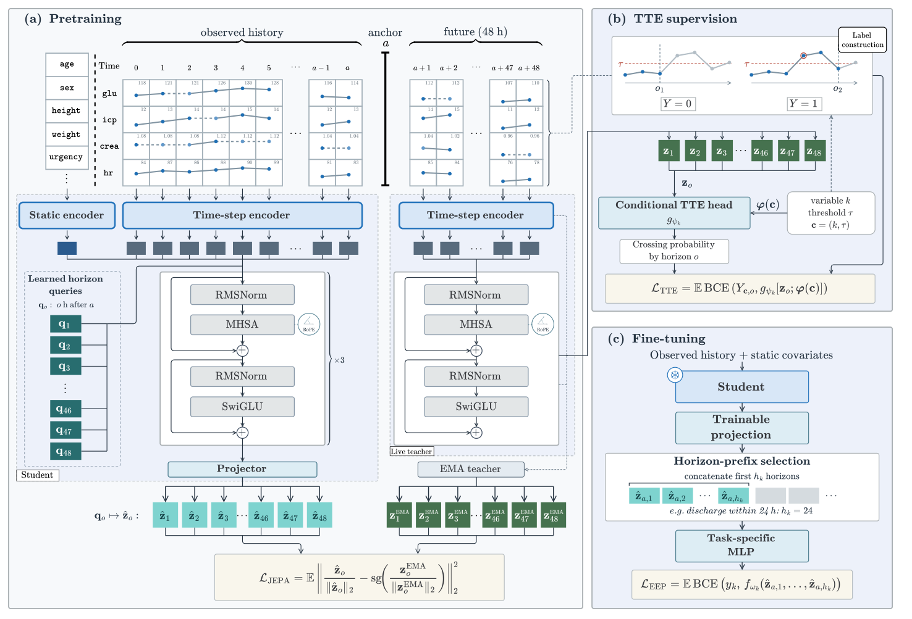

# TTE-JEPA
**Predicting future representations in ICU time series using time-to-event supervision**
[Paper](https://openreview.net/forum?id=Pbip79APoK) · [Data preprocessing](https://github.com/riic-lab/MetaICU) · [Architecture](ARCHITECTURE.md) · [Data format](DATA_FORMAT.md)
TTE-JEPA learns representations of patient history by predicting a teacher's representation of future observations. Time-to-event supervision trains the future teacher, and an exponential moving average of that teacher supplies targets for the history encoder. The learned history representations support downstream clinical prediction.

The history encoder is a three-layer Transformer with 48 horizon queries. The future teacher has its own timestep encoder and one causal Transformer block. Downstream fitting freezes the history encoder and trains a projection and task-specific heads. See [ARCHITECTURE.md](ARCHITECTURE.md) for dimensions, objectives and training settings.
## Installation
Use Python with PyTorch 2.5 or later. From the repository root:
```bash
pip install -r requirements.txt
```
EHRMamba also needs CUDA-compatible `mamba-ssm` kernels exposing `Mamba3`; see [requirements-mamba.txt](requirements-mamba.txt). The other models do not require Mamba.
## Prepare the data
Prepare normalized hourly grids with [MetaICU](https://github.com/riic-lab/MetaICU), using separate training, validation and test folds. The CLI takes a schema directory and a grid-cache directory; their required files and array layouts are described in [DATA_FORMAT.md](DATA_FORMAT.md). Dataset files and pretrained weights are not included.
The implementation includes the original seven clinical endpoints. Dataset profiles are `joint`, `mono` and `debug10`; `debug10` expects a separately prepared small dataset.
## Training and evaluation
Run pretraining, downstream fitting and test evaluation on one GPU:
```bash
python -m CLI.train run \
  --model tte_jepa --dataset joint --device cuda \
  --seed "$SEED" \
  --data-dir /path/to/schema \
  --cache-dir /path/to/prepared_grids \
  --output-dir /path/to/run
```
Set `SEED` to an integer of your choice. Every entry point requires an explicit `--seed`; the YAML files contain no default seed.
Use `pretrain`, `finetune` or `evaluate` instead of `run` for an individual stage. Pass `--checkpoint` to load the relevant pretrained or downstream weights, and `--resume` to continue training. `--config` selects a model YAML; available settings are listed in [configs/README.md](configs/README.md). For CPU execution, use `--device cpu`.
Runs save the resolved configuration, checkpoints, JSONL training logs, representation caches, metrics and Parquet predictions. Checkpoints are selected on validation data; test evaluation follows model selection.
## Baselines
Change `--model` in the command above to select a baseline. Each model loads its corresponding YAML from `configs/`.

| Model    | CLI value  | Representation training                |
| -------- | ---------- | -------------------------------------- |
| TTE-JEPA | `tte_jepa` | TTE-supervised future teacher          |
| ICareFM  | `icarefm`  | Next-state prediction followed by TTE  |
| HEPA     | `hepa`     | Latent alignment with SIGReg           |
| EHRMamba | `ehrmamba` | TTE with a six-block Mamba-3 backbone  |
| XGBoost  | `xgboost`  | Classifiers on causal summary features |
All models use the same prepared splits, endpoint labels and admission-balanced evaluation. ICareFM includes a separate `tte` stage. XGBoost uses `finetune` for classifier fitting and has no representation-pretraining stage; resume keeps completed task models and restarts unfinished fits. EHRMamba requires `--device cuda`.
Baseline architectures and readouts are specified in [ARCHITECTURE.md](ARCHITECTURE.md#baselines).
## Synthetic example
Check the pipeline with generated inputs before preparing a full dataset:
```bash
python -m CLI.smoke_pipeline --seed "$SEED"
```
The smoke command accepts the same `--model` selector. EHRMamba also requires `--device cuda` here.
## Code layout
- `model/`, `baselines/`: encoders, teachers and downstream heads.
- `training/`, `evaluation/`: stage orchestration, checkpointing, inference and metrics.
- `loss/`: objectives and admission-weighted reductions.
- `utils/`: data loading, labels and sampling.
- `configs/`, `CLI/`: YAML settings and command-line entry points.
## Citation
Citation details are available on the [paper's OpenReview page](https://openreview.net/forum?id=Pbip79APoK).
## License
The code is released under the [MIT License](LICENSE). The manuscript figure is licensed under [CC BY 4.0](https://creativecommons.org/licenses/by/4.0/); see its [attribution](docs/figures/README.md).
